# njia, the Swift package


**The Swift Package Manager distribution of njia, the flow navigation engine behind the Smile ID
SDKs.** This repository holds the `Package.swift` manifest, and each release carries the
xcframeworks it points at.

An SDK describes its flow as a graph of steps. The engine keeps the back stack as plain state and
decides where next, back and skip go, and the host only draws the entries the engine holds.

<picture>
  <source media="(prefers-color-scheme: dark)" srcset="assets/readme/hero-dark.svg">
  
</picture>

<p align="center"><sub>Each intent names the entry it came from. A late <code>next</code> from a covered entry is stale and moves nothing; a fact repeats the document segment for the back; <code>back</code> pops.</sub></p>

<picture>
  <source media="(prefers-color-scheme: dark)" srcset="assets/readme/facts-dark.svg">
  
</picture>

> [!IMPORTANT]
> No release yet. The snapshots on [Releases](https://github.com/smileidentity/njia-spm/releases)
> are for testing: pin one exactly, as below. njia's first release replaces this note.

## Install

In Xcode, choose **File → Add Package Dependencies…** and enter
`https://github.com/smileidentity/njia-spm`. Or add it to your own `Package.swift`:

```swift
dependencies: [
    .package(url: "https://github.com/smileidentity/njia-spm", exact: "0.0.1-SNAPSHOT.4")
]
```

Pin it `exact`. The Flutter plugin `usesmileid_njia` and the React Native package `@smileid/njia`
each pin this package exactly at their own version, so an app that carries one of them and the
native SDK resolves one `Njia.framework`.

## Products

| Product | What it holds |
|---|---|
| `Njia` | The graph, state, intents and effects, the reducer, `NjiaEngine`, the delivery gate and the codec, behind the `NjiaKit` front door. Foundation only |
| `NjiaUI` | `NjiaHost`, the SwiftUI host, and `NjiaPreview` for `#Preview`s |
| `NjiaTesting` | `FakeNjiaNavigator` and `RecordingNjiaListener`, for test targets only |

| iOS | Swift tools | Built with | Dependencies |
|---|---|---|---|
| 15.0 or later | 6.0 or later | Xcode 26.4 | Foundation; `NjiaUI` adds SwiftUI |

## Releases

Each [release](https://github.com/smileidentity/njia-spm/releases) carries the three xcframeworks
with their SHA-256 sums, and its notes list what changed. A snapshot is a prerelease named
`x.y.z-SNAPSHOT.N`, for testing only.

> [!NOTE]
> Each njia release writes this README, its figures and the manifest, so a change made here is
> replaced by the next one.

## License

MIT. See [LICENSE](LICENSE).
