# njia, the Swift package

The Swift Package Manager distribution of **njia**, the flow navigation engine behind the Smile ID
SDKs.

<picture>
  <source media="(prefers-color-scheme: dark)" srcset="assets/readme/spm-install-dark.svg">
  
</picture>

## Install

```swift
.package(url: "https://github.com/smileidentity/njia-spm", exact: "0.0.1-SNAPSHOT.11")
```

Pin it exactly. The Flutter and React Native packages pin this one at their own version, so an app
that carries one of them and the native SDK resolves one `Njia`.

| Product | For |
|---|---|
| `Njia` | the engine. Start here |
| `NjiaUI` | the SwiftUI host |
| `NjiaTesting` | test targets only |

iOS 15 or later · Swift tools 6.0 · built with Xcode 27.1 · no third-party dependencies

## Releases

[Releases](https://github.com/smileidentity/njia-spm/releases) lists every version with its
xcframeworks and their SHA-256 sums. A snapshot, `x.y.z-SNAPSHOT.N`, is for testing only.

MIT licensed. See [LICENSE](LICENSE).
